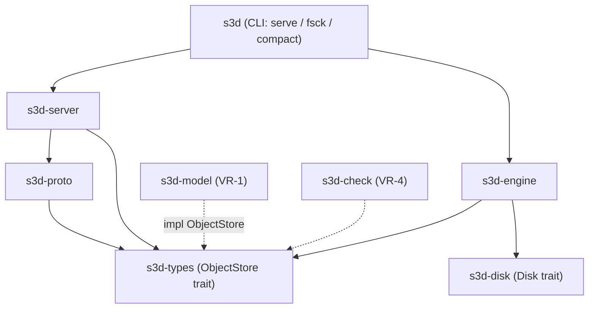

# 01 · 总体架构与核心 Trait 设计

本文档将《需求规格书》第 3、4、8、9、10 节落地为 Cargo Workspace 边界、核心 Trait 签名、全链路请求流水线与 CLI/配置结构。所有后续模块实现与参考模型对拍均以此接口契约为准。

---

## 1. Workspace 结构与依赖方向

规格书第 3 节定义了 6 个核心库与 `fuzz/`。为确保 `s3d-model` 与 `s3d-engine` 完全不依赖 HTTP/XML 库，同时消除循环依赖，提取纯内存、零 IO 依赖的 `s3d-types` 承载共享领域类型与 `ObjectStore` trait；可执行二进制 `s3d` 由 `s3d-server`（`src/bin/s3d.rs`）产出。

```text
s3d/
  Cargo.toml              workspace 根，统一锁版本与 lints（#![forbid(unsafe_code)]）
  crates/
    s3d-types/            共享值类型、错误枚举、ObjectStore trait（零 IO / HTTP 依赖）
    s3d-disk/             Disk / FileHandle trait、OsDisk（生产）、FaultDisk（VR-3 故障注入）
    s3d-engine/           WAL、段文件、检查点、内存索引、Group Commit、GC、fsck
    s3d-model/            可执行规格参考模型（VR-1，纯 BTreeMap 实现 ObjectStore）
    s3d-proto/            寻址、SigV4、预签名、aws-chunked、校验和与合并、XML 编解码、策略/ACL 语法
    s3d-server/           hyper HTTP/1.1 接入、流水线编排、管理端口（/metrics, /health）、CLI 入口
    s3d-check/            单 key WGL 线性一致性检查器与并发历史记录器（VR-4）
  fuzz/                   8 个 cargo-fuzz 目标（VR-7）
  scripts/                s3-tests 归类脚本、压测驱动、boto3/awscli 验收脚本
  docs/                   设计文档与 deviations.md
```

**单向依赖关系**（生产路径无环，测试替身横向替换）：



| Crate | 允许依赖的外部库 | 严禁引入 |
| --- | --- | --- |
| `s3d-types` | `bytes`、`thiserror` | `tokio::net`、`hyper`、`quick-xml`、文件系统 IO |
| `s3d-disk` | `libc`（仅限 `pread`/`pwrite`/`fdatasync`/`statvfs`/`flock` 封装，单独过 Miri 审查，`VR-10`） | `tokio`、业务语义 |
| `s3d-engine` | `crc32c`、`tokio`（经 `sync` 垫片可切换至 `shuttle`/`loom`）、`tracing` | `hyper`、`quick-xml`、任何嵌入式 KV |
| `s3d-model` | 标准库 `BTreeMap`、`bytes`、摘要/CRC 库 | 磁盘 IO、锁并发优化、第三方存储库 |
| `s3d-proto` | `http`、`bytes`、`quick-xml`、摘要/HMAC/CRC 库 | `s3d-engine`、`s3d-disk` |
| `s3d-server` | `tokio`、`hyper`、`hyper-util`、`clap`、`toml`、`tracing` | 直接操作段文件或 WAL |

---

## 2. 并发原语垫片（支持 Shuttle / Loom，`VR-4`）

为复用 ShardStore 验证方案，`s3d-engine` 内部禁止直接 `use std::sync::*` 或 `use tokio::sync::*`，统一通过内部模块 `crate::sync` 导出原语，由 Cargo feature 在编译期切换：

| 原语 | 默认（生产 / `VR-2` / `VR-3`） | `--features shuttle`（`VR-4` 大场景） | `--features loom`（`VR-4` 小原语） |
| --- | --- | --- | --- |
| 互斥锁 / 读写锁 | `parking_lot` 或 `std::sync::{Mutex, RwLock}` | `shuttle::sync::{Mutex, RwLock}` | `loom::sync::{Mutex, RwLock}` |
| 原子类型 | `std::sync::atomic::*` | `shuttle::sync::atomic::*` | `loom::sync::atomic::*` |
| 条件变量 / 通知 | `tokio::sync::{Notify, oneshot}` | `shuttle::future` + `shuttle::sync` | `loom::sync::Condvar` |
| 线程 / 任务派生 | `tokio::task::{spawn, spawn_blocking}` | `shuttle::future::spawn` | `loom::thread::spawn` |
| 时钟与随机数 | 系统单调时钟 / OS CSPRNG | `shuttle` 可复现种子时钟与 RNG | 固定测试输入 |

---

## 3. `Disk` Trait 设计（`s3d-disk`）

所有持久化读写均经由同步原语接口 `Disk` 完成：
- **生产路径（`OsDisk`）**：使用底层文件描述符的定位读写（`pread` / `pwrite`，多线程共享同一 fd 无游标竞争），配合 `tokio::task::spawn_blocking`（小元数据走专用刷盘线程，流式大块走阻塞池）驱动。
- **测试路径（`FaultDisk`）**：纯内存扇区数组直接返回，零系统调用开销，支持在 `VR-3` 中每秒跑数百轮掉电恢复，在 `VR-4` 中配合 `shuttle` 确定性调度。

```rust
pub type DiskResult<T> = Result<T, DiskError>;

#[derive(Debug, Clone, Copy, PartialEq, Eq)]
pub enum DiskError {
    NotFound,
    AlreadyExists,
    IoError,       // 对应 EIO；fsync 遇到此错误触发引擎只读熔断（§10 硬规则）
    NoSpace,       // 对应 ENOSPC
    InvalidInput,
}

pub trait Disk: Send + Sync + 'static {
    type File: DiskFile;

    /// 创建或打开文件；create_new=true 对应 O_CREAT | O_EXCL
    fn open(&self, rel_path: &str, opts: OpenOptions) -> DiskResult<Self::File>;

    /// 原子重命名（检查点替换 ST-8）
    fn rename(&self, from: &str, to: &str) -> DiskResult<()>;

    /// 删除文件（必须先在 WAL 记录删除意图 ST-7）
    fn remove_file(&self, rel_path: &str) -> DiskResult<()>;

    /// 列举子目录内文件名（恢复扫描 wal/、seg/、ckpt/、清空 tmp/）
    fn read_dir(&self, rel_dir: &str) -> DiskResult<Vec<String>>;

    /// 确保目录存在
    fn create_dir_all(&self, rel_dir: &str) -> DiskResult<()>;

    /// fsync 目录项，保证新建/重命名/删除文件元数据持久化（ST-7, ST-8）
    fn sync_dir(&self, rel_dir: &str) -> DiskResult<()>;

    /// 返回数据目录所在文件系统的可用字节数（NFR-16）
    fn available_bytes(&self) -> DiskResult<u64>;

    /// 进程级排他锁（防止双实例挂载同一 data_dir）
    fn try_lock_exclusive(&self) -> DiskResult<Box<dyn Send + Sync>>;
}

pub trait DiskFile: Send + Sync + 'static {
    /// 定位读（pread）：不改变文件游标，支持无锁并发读段文件
    fn read_exact_at(&self, offset: u64, buf: &mut [u8]) -> DiskResult<()>;

    /// 定位写（pwrite）：支持多流按原子预留偏移并发写活跃段文件
    fn write_all_at(&self, offset: u64, buf: &[u8]) -> DiskResult<()>;

    /// 截断或扩展文件长度（恢复时截断 WAL 撕裂尾部 ST-6）
    fn set_len(&self, size: u64) -> DiskResult<()>;

    /// 当前文件字节长度
    fn len(&self) -> DiskResult<u64>;

    /// 数据与必要元数据落盘（fdatasync / fsync）
    fn sync_data(&self) -> DiskResult<()>;
}
```

---

## 4. `ObjectStore` Trait 设计（`s3d-types`）

### 4.1 设计难点与解法

`ObjectStore` 必须同时满足三件事：
1. **流式零缓冲（`NFR-5`）**：10 GiB 上传/下载不能驻留内存，单在途请求缓冲 ≤ 2 MiB。
2. **先流式校验，后提交点验条件（`PR-21`, `FR-17`, `8.3`）**：请求体边读边算 SHA-256 / MD5 / Checksum（包括 `aws-chunked` 尾部块），摘要全部校验通过后才允许提交；条件头（`If-Match` / `If-None-Match`）必须在流读完后的 **key 锁提交点**求值。
3. **与参考模型同构（`VR-1`, `VR-2`）**：`s3d-model` 只需把流拼成 `Bytes`，无需任何分块、预写日志或磁盘 IO 状态机即可实现完全一致的外部可观测语义。

解法是将写入拆为输入流契约 `VerifiedBodyStream`：流在产生字节块的过程中由协议层流式计算并校验 Payload SHA-256、`Content-MD5` 及 `x-amz-checksum-*`；引擎把字节块追加到活跃段文件，直到调用 `finish()` 拿到经协议层确认的 `(md5, checksum)`（若校验失败则流返回 `BodyError`，引擎直接丢弃未引用的段块，不写 WAL）。

```rust
/// 协议层提供给存储层的流式写数据源
pub trait VerifiedBodyStream: Send {
    /// 拉取下一块解码后数据（建议块上限 64 KiB ~ 256 KiB）；返回 Ok(None) 表示到达 EOF
    fn poll_next_chunk(
        &mut self,
        cx: &mut Context<'_>,
    ) -> Poll<Result<Option<Bytes>, BodyStreamError>>;

    /// 仅在 poll_next_chunk 返回 Ok(None) 后调用，返回已完成尾部校验的最终摘要
    fn take_verified_digests(&mut self) -> Result<VerifiedDigests, BodyStreamError>;
}

#[derive(Debug, Clone)]
pub struct VerifiedDigests {
    pub total_bytes: u64,
    pub md5: [u8; 16],               // 用于生成单次 PUT 或分片的 ETag（FR-7）
    pub checksum: ChecksumValue,     // 客户端指定算法校验通过的值，或服务端默认算出的 CRC64NVME（PR-22）
}

#[derive(Debug)]
pub enum BodyStreamError {
    Sha256Mismatch,                  // -> 400 XAmzContentSHA256Mismatch (PR-11)
    BadDigest,                       // -> 400 BadDigest (PR-21)
    InvalidChunkedEncoding,          // -> 400 InvalidRequest / IncompleteBody (PR-12)
    EntityTooLarge,                  // -> 400 EntityTooLarge (chunked 流超 5 GiB)
    EntityTooSmall,                  // -> 400 EntityTooSmall
    ClientDisconnected,              // 客户端断连，静默中止，已写段块交由 GC 回收
}
```

读取方向返回 `ObjectReader`，在 `s3d-engine` 中内部持有段文件的只读引用计数守卫（`SegmentPin`），按块（≤ 1 MiB）读取并校验 `CRC32C`（`ST-5`），`Drop` 时自动释放引用计数。

### 4.2 `ObjectStore` 接口全景（一次性预留 P0 / P1 / P2 扩展位）

```rust
pub trait ObjectStore: Send + Sync + 'static {
    type Reader: AsyncByteReader + Send + 'static;

    // ---- 桶生命周期与子资源（P0 + P1/P2 桶级配置槽位） ----
    fn list_buckets(&self, req: ListBucketsReq) -> impl Future<Output = StoreResult<ListBucketsResp>> + Send;
    fn create_bucket(&self, req: CreateBucketReq) -> impl Future<Output = StoreResult<CreateBucketResp>> + Send;
    fn head_bucket(&self, req: BucketRef) -> impl Future<Output = StoreResult<BucketMetaSnapshot>> + Send;
    fn delete_bucket(&self, req: BucketRef) -> impl Future<Output = StoreResult<()>> + Send;
    fn get_bucket_config(&self, bucket: &str, kind: BucketConfigKind) -> impl Future<Output = StoreResult<BucketConfigValue>> + Send;
    fn put_bucket_config(&self, bucket: &str, val: BucketConfigUpdate) -> impl Future<Output = StoreResult<()>> + Send;

    // ---- 对象核心读写删与属性（P0 + 版本/条件/标签/ACL/锁） ----
    fn put_object<S: VerifiedBodyStream>(
        &self,
        req: PutObjectReq,
        body: S,
    ) -> impl Future<Output = StoreResult<PutObjectResp>> + Send;

    fn get_object(&self, req: GetObjectReq) -> impl Future<Output = StoreResult<GetObjectResp<Self::Reader>>> + Send;
    fn head_object(&self, req: GetObjectReq) -> impl Future<Output = StoreResult<ObjectMetaSnapshot>> + Send;
    fn delete_object(&self, req: DeleteObjectReq) -> impl Future<Output = StoreResult<DeleteObjectResp>> + Send;
    fn delete_objects(&self, req: DeleteObjectsReq) -> impl Future<Output = StoreResult<DeleteObjectsResp>> + Send;
    fn copy_object(&self, req: CopyObjectReq) -> impl Future<Output = StoreResult<CopyObjectResp>> + Send;
    fn get_object_attributes(&self, req: GetObjectAttributesReq) -> impl Future<Output = StoreResult<ObjectAttributesResp>> + Send;

    // ---- P1 / P2 对象子资源原子更新（Tagging / ACL / Retention / LegalHold） ----
    fn get_object_subresource(&self, req: ObjectSubresourceReq) -> impl Future<Output = StoreResult<ObjectSubresourceVal>> + Send;
    fn put_object_subresource(&self, req: PutObjectSubresourceReq) -> impl Future<Output = StoreResult<()>> + Send;

    // ---- 列举（V1 / V2 / Versions） ----
    fn list_objects_v1(&self, req: ListObjectsV1Req) -> impl Future<Output = StoreResult<ListObjectsV1Resp>> + Send;
    fn list_objects_v2(&self, req: ListObjectsV2Req) -> impl Future<Output = StoreResult<ListObjectsV2Resp>> + Send;
    fn list_object_versions(&self, req: ListObjectVersionsReq) -> impl Future<Output = StoreResult<ListObjectVersionsResp>> + Send;

    // ---- 分片上传 ----
    fn create_multipart_upload(&self, req: CreateMultipartReq) -> impl Future<Output = StoreResult<CreateMultipartResp>> + Send;
    fn upload_part<S: VerifiedBodyStream>(
        &self,
        req: UploadPartReq,
        body: S,
    ) -> impl Future<Output = StoreResult<UploadPartResp>> + Send;
    fn upload_part_copy(&self, req: UploadPartCopyReq) -> impl Future<Output = StoreResult<UploadPartCopyResp>> + Send;
    fn complete_multipart_upload(&self, req: CompleteMultipartReq) -> impl Future<Output = StoreResult<CompleteMultipartResp>> + Send;
    fn abort_multipart_upload(&self, req: AbortMultipartReq) -> impl Future<Output = StoreResult<()>> + Send;
    fn list_parts(&self, req: ListPartsReq) -> impl Future<Output = StoreResult<ListPartsResp>> + Send;
    fn list_multipart_uploads(&self, req: ListMultipartUploadsReq) -> impl Future<Output = StoreResult<ListMultipartUploadsResp>> + Send;
}
```

> **授权职责边界**：为使 `VR-2` 能直接对拍 P1 的 ACL / Bucket Policy / PublicAccessBlock 行为，每次 `ObjectStore` 调用均携带 `CallerContext { account: Option<AccountId>, request_time_ms: i64, is_presigned: bool, source_ip: IpAddr, ... }`，授权纯函数（定义在 `s3d-proto::authz` 或 `s3d-types::authz`）在读取/提交的原子视图上统一执行，保证引擎与模型在并发修改桶策略或 ACL 时的行为 100% 一致。

---

## 5. HTTP 全链路请求流水线（`s3d-server` + `s3d-proto`）

```text
TCP 连接准入 (max_connections → 503 SlowDown, NFR-9)
  │
  ▼
读请求头 (30s 超时断开 NFR-9; 头总长 > 8 KB → 400 RequestHeaderSectionTooLarge PR-19)
  │
  ▼
生成 RequestContext (16 位大写 hex request_id, x-amz-id-2, 起始时间戳 PR-15)
  │
  ▼
1. 寻址与路由解析 (PR-1 ~ PR-5)
   ├─ Host 匹配 base_domain → virtual-hosted，否则 path-style
   ├─ URI 单次百分号解码（+ 保字面量，不归一化 . / .. / //）
   ├─ 子资源识别：黑名单子资源立即回 501 NotImplemented
   └─ CORS OPTIONS 预检分流（P1）
  │
  ▼
2. 认证 SigV4 / 预签名 / POST Policy / 匿名识别 (PR-6 ~ PR-10)
   ├─ SigV2 / SigV4a → 400 InvalidRequest
   ├─ 时钟偏差 > 15 min → 403 RequestTimeTooSkewed
   ├─ 查静态账号表 + 常数时间比较 HMAC → 403 InvalidAccessKeyId / SignatureDoesNotMatch
   └─ 校验区域匹配 (PR-4) 与预签名有效期 1~604800s (PR-10)
  │
  ▼
3. 前置限额、只读态与授权预检（均在消费请求体之前完成！）
   ├─ 写请求检查引擎只读熔断态 → 500 InternalError；检查磁盘剩余空间 < 2 GiB → 503 SlowDown (NFR-16)
   ├─ 桶存在性与 x-amz-expected-bucket-owner 校验 (PR-29)
   ├─ 授权判定（桶策略 Deny → 所有者 → 桶策略 Allow / ACL，叠加 PublicAccessBlock，PR-28 ~ PR-33）
   └─ 请求头限额校验（key > 1024B、user_meta > 2KB、Content-Length > 5GiB、非法校验和头等）
  │
  ▼  ◀── 若第 1~3 步任一失败：不 poll hyper Incoming body，直接返回错误状态码（天然拒绝 100-continue，PR-13）
  │  ◀── 若第 1~3 步全部通过：首次 poll body 时 hyper 自动发出 `HTTP/1.1 100 Continue`
  ▼
4. 请求体流式处理
   ├─ XML 控制类请求（Complete ≤ 2 MiB，其余 ≤ 1 MiB，关闭 DTD/实体 NFR-8）→ 解析为强类型结构
   └─ 数据类写请求（PutObject / UploadPart）→ 包装为 VerifiedBodyStream（逐块验 aws-chunked、算摘要）
  │
  ▼
5. 调用 ObjectStore 执行与原子提交
   └─ 写请求落段 → 摘要核对 → 段 fdatasync → key 锁内重求值条件 (FR-17) → WAL Group Commit → 更新索引
  │
  ▼
6. 响应编码与可观测性收尾
   ├─ 统一注入 x-amz-request-id、x-amz-id-2、Date、Server: s3d (PR-15)
   ├─ HEAD 请求遇到错误只发状态码与响应头，剥离 XML body (PR-18)
   └─ 记录单行 JSON 访问日志 (NFR-10) + 更新 Prometheus 指标计数器与延迟直方图 (NFR-11)
```

---

## 6. CLI、配置文件与凭证格式

### 6.1 CLI 子命令

```text
s3d serve   [--config s3d.toml] [--listen ...] [--data-dir ...]   # 启动服务（支持 CLI 覆盖 TOML，NFR-15）
s3d fsck    --data-dir <dir> [--json]                             # 离线全量完整性校验，退出码 0=干净 / 1=损坏（NFR-13）
s3d compact --data-dir <dir>                                      # 离线或通过管理接口触发手动段压缩（NFR-14）
```

配置解析采用 `serde` 的 `#[serde(deny_unknown_fields)]`，遇到未知配置键立即报错退出（`NFR-15`）。配置项默认值严格对齐规格书附录 C。

### 6.2 凭证文件格式（`credentials.toml`）

启动时调用 `stat` 检查文件权限，若 `(mode & 0o777) != 0o600` 拒绝启动并打印明确错误（`NFR-7`）；`SecretKey` 类型手写 `Debug` / `Display` 固定输出 `[REDACTED]`，杜绝写入日志或错误消息。

为满足 `s3-tests` 八个配置段（`[s3 main]`、`[s3 alt]`、`[s3 tenant]`、`[iam]`、`[iam root]`、`[iam alt root]`，附录 B），预置至少 6 个独立账号，每个账号完整包含以下字段：

```toml
[[accounts]]
user_id = "0123456789abcdef0123456789abcdef0123456789abcdef0123456789abcdef"
display_name = "s3d-main"
email = "main@example.com"
access_key = "S3DMAINACCESSKEY0001"
secret_key = "s3d-main-secret-key-00000000000000000001"
```

引擎在内存与 WAL 中通过 `user_id` 字符串关联资源所有者（兼容凭证轮换 AK/SK 而不丢失桶归属），启动时建立 `access_key -> Account`、`user_id -> Account`、`email -> Account`（供 P1 ACL `emailAddress` 授权使用）三张只读映射表。

### 6.3 独立管理端口与优雅停机（`NFR-12`, `NFR-14`）

- 管理 HTTP 服务默认监听 `127.0.0.1:9000`，仅暴露两个路由：
  - `GET /health`：正常态返回 `200 OK`（`{"status":"ok"}`）；引擎 `fsync` 熔断只读态或正在停机排空时返回 `503 Service Unavailable`。
  - `GET /metrics`：输出 Prometheus text exposition 格式指标（无需引入重型 SDK，引擎原子计数器 + 固定桶直方图直接格式化输出）。
- **SIGTERM / SIGINT 停机序列**：
  1. 管理端口 `/health` 置为 `draining`，S3 监听 socket 停止 `accept` 新连接。
  2. 等待在途请求完成，总宽限期最多 30 秒；空闲连接立即关闭。
  3. 停止后台 GC 与定期检查点任务。
  4. 若引擎处于健康态（非 `ReadOnlyPoisoned`），执行一次全量检查点落盘（`ST-8`），加快下次冷启动速度（`NFR-6`）。
  5. 释放 `data_dir` 排他锁，进程以状态码 `0` 退出。
