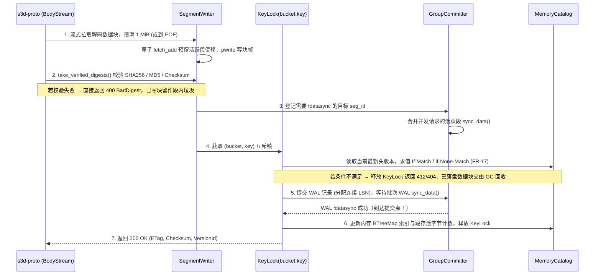

# 02 · 存储引擎与磁盘格式详细设计

本文档将《需求规格书》第 8 节及 `ST-1`～`ST-9`、`NFR-4`～`NFR-6`、`NFR-13`、`NFR-16` 落地为精确的二进制磁盘布局、内存结构预算、并发写与 Group Commit 状态机、崩溃恢复算法及并发压缩（GC）协议。磁盘格式一次性覆盖 M0～M4 所需元数据，后续里程碑无需破坏性迁移。

---

## 1. 目录与文件命名规范（`ST-7`, `ST-9`）

所有路径仅包含固定前缀与十六进制/十进制编号，严禁将桶名或对象 key 映射进文件名（`ST-9`）：

```text
<data_dir>/
  LOCK                        进程排他锁文件（flock LOCK_EX | LOCK_NB）
  FORMAT                      实例身份与磁盘格式版本（48 B，原子创建，只读校验）
  wal/
    00000001.log              预写日志，8 位十进制递增（wal_seq: u32），满 256 MiB 滚动
  ckpt/
    ckpt-0000000000000400     元数据快照，16 位小写十六进制 LSN，字典序即 LSN 升序
  seg/
    00000001.seg              数据段文件，8 位十进制递增（seg_id: u32），满 1 GiB 滚动
  tmp/
    ckpt-0000000000000400.tmp 临时写文件，启动恢复时无条件清空 tmp/
```

所有多字节整数统一采用 **小端序（Little-Endian）**，所有校验和统一使用硬件加速的 **CRC32C（Castagnoli）**。

---

## 2. 二进制磁盘格式规范

### 2.1 `FORMAT` 文件（固定 48 字节）

首次初始化空目录时，写入 `tmp/FORMAT.tmp` → `sync_data` → `rename("tmp/FORMAT.tmp", "FORMAT")` → `sync_dir("")`。

| 偏移 | 长度 | 字段 | 说明 |
| --- | --- | --- | --- |
| 0 | 8 | `magic` | `b"S3DFMT01"` |
| 8 | 4 | `format_ver` | `u32 = 1`；不匹配时拒绝启动 |
| 12 | 4 | `flags` | 预留标志位，当前为 `0` |
| 16 | 16 | `instance_uuid` | 128 位随机实例 UUID；所有 WAL/段/检查点文件头携带其低 64 位防跨库混入 |
| 32 | 8 | `created_ms` | 初始化 UTC 毫秒时间戳（`i64`） |
| 40 | 4 | `reserved` | `0` |
| 44 | 4 | `crc32c` | 前 44 字节的 CRC32C |

### 2.2 段文件（`seg/%08u.seg`）与数据块帧

**段文件头（固定 32 字节，偏移 `0`）**：

| 偏移 | 长度 | 字段 | 说明 |
| --- | --- | --- | --- |
| 0 | 8 | `magic` | `b"S3DSEG01"` |
| 8 | 4 | `seg_id` | 段编号（`u32`，与文件名一致，从 `1` 开始） |
| 12 | 4 | `format_ver` | `u32 = 1` |
| 16 | 8 | `instance_uuid_lo` | `FORMAT.instance_uuid` 低 64 位 |
| 24 | 4 | `created_sec` | 创建时间秒级时间戳（`u32`） |
| 28 | 4 | `header_crc32c` | 前 28 字节的 CRC32C |

**数据块帧（偏移 ≥ 32，顺序紧邻追加，单块 payload ≤ 1 MiB = `1,048,576` 字节）**：

```text
+------------------+------------------+--------------------+-----------------------+
| block_magic: u32 | payload_len: u32 | payload_crc32c:u32 | payload [0..=1048576] |
+------------------+------------------+--------------------+-----------------------+
  0x5333424B ("S3BK")   0 ..= 1048576     CRC32C(payload)
```

- **设计依据**：单块上限 1 MiB 保证任意 `Range` 读（哪怕只读 1 字节）都可以整块读出、先通过 `CRC32C` 校验再返回切片（严格满足 `ST-5`），同时单次读缓冲远低于 `NFR-5` 的 2 MiB 上限。
- **Extent 定义**：`Extent { seg_id: u32, offset: u64, len: u32, crc32c: u32 }`。其中 `offset` 指向块头起始位置，`len == payload_len`，`crc32c == payload_crc32c`。读取时单次 `pread(offset, 12 + len)` 同时完成块头核对与数据校验。
- **单归属不变量**：每个已提交的物理数据块在任意时刻最多属于一个 `ObjectVersion` 或一个 `Open` 态的 `Upload` 分片（`CompleteMultipartUpload` 将分片 extent 所有权零拷贝转移给新 `ObjectVersion`；`CopyObject` 流式写入新块）。这使每段的存活字节统计退化为精确的原子加减，无需维护块级引用计数表。

### 2.3 WAL 文件（`wal/%08u.log`）与记录格式

**WAL 文件头（固定 32 字节，偏移 `0`）**：

| 偏移 | 长度 | 字段 | 说明 |
| --- | --- | --- | --- |
| 0 | 8 | `magic` | `b"S3DWAL01"` |
| 8 | 4 | `wal_seq` | WAL 文件序号（`u32`，从 `1` 开始） |
| 12 | 4 | `header_crc32c` | 除本字段外其余 28 字节的 CRC32C |
| 16 | 8 | `first_lsn` | 本文件首条记录的预期 LSN（首文件为 `1`） |
| 24 | 8 | `instance_uuid_lo` | `FORMAT.instance_uuid` 低 64 位 |

**WAL 记录帧（偏移 ≥ 32）**：

```text
+----------+-------------+----------+----------------+-----------+-------------+---------------+
| len: u32 | crc32c: u32 | lsn: u64 | synced_lsn:u64 | type: u8  | ver: u8     | payload: [u8] |
+----------+-------------+----------+----------------+-----------+-------------+---------------+
|<--- 8B 外帧头 -------->|<---------------------- len 字节 (上限 16 MiB) --------------------->|
```

- `crc32c`：覆盖 `len`（4B）及随后的全部 `len` 字节（防止 `len` 单比特翻转碰巧碰撞）。
- `lsn`：全局严格连续递增（`prev_lsn + 1`）。
- `synced_lsn`：**写入本批次时已完成 `fdatasync` 的最大 LSN**。Group Commit 严格串行刷盘（上一批 `fdatasync` 返回后才 `pwrite` 下一批）。恢复扫描遇到损坏记录 `pos` 时，向后按字节/扇区扫描：
  - 若后续存在合法记录（`magic`/帧校验通过且 `record.synced_lsn >= expected_lsn_at_pos`），证明 `pos` 所在批次当年已成功 `fdatasync`，属于**已提交记录中间损坏** → 立即拒绝启动并报告文件与偏移（`ST-6`）。
  - 若后续无此类记录，证明从 `pos` 到 EOF 均属于最后一批未完成 `fdatasync` 的在途写（即使 `FaultDisk` 在掉电时跨 4 KiB 扇区乱序落盘了尾部扇区），安全判定为**尾部撕裂** → `set_len(pos)` 截断后继续启动（`ST-6`）。

**WAL 记录类型（`type: u8`）**：

| 值 | 名称 | 触发时机与语义 |
| --- | --- | --- |
| `0x01` | `InternAccount` | 首次见到新账号 `user_id` 时分配进程内紧凑 `owner_idx: u16` 并持久化映射 |
| `0x10` | `CreateBucket` | 新建桶及其初始归属、区域、Ownership、ObjectLock 标志 |
| `0x11` | `UpdateBucketConfig` | 原子更新桶的 Versioning / ACL / Policy / PAB / CORS / Tags / Lifecycle / SSE / Logging |
| `0x12` | `DeleteBucket` | 删除空桶 |
| `0x20` | `PutVersion` | 写入新对象版本或删除标记（含 `seq`、覆盖旧 `null` 版本指示、extents、摘要、元数据） |
| `0x21` | `DeleteVersion` | 按 `versionId`（或未开启版本控制时）永久删除指定版本 |
| `0x22` | `UpdateVersionMeta` | P1/P2 原地更新指定版本的 Tags / ACL / Retention / LegalHold |
| `0x30` | `InitiateUpload` | 创建分片上传会话 |
| `0x31` | `PutUploadPart` | 提交单个分片的 extents、ETag 与校验和（若同段号重传则替换旧段） |
| `0x32` | `CompleteUpload` | 原子生成新 `ObjectVersion`（接管分片 extents），并将 `Upload` 置为 `Completed` 保留 24h |
| `0x33` | `AbortUpload` | 将 `Upload` 置为 `Aborted`，释放所有分片 extents 计入段垃圾 |
| `0x34` | `ExpireCompletedUpload` | 清理超过 24 小时保留期的 `Completed` 上传缓存记录 |
| `0x40` | `CreateSegment` | 记录新段 `seg_id` 已创建并完成父目录 `fsync` |
| `0x41` | `RelocateExtents` | GC 压缩将一批仍存活的 `(bucket, key, seq, extent_idx)` 从旧段原子重定位至新段 |
| `0x42` | `DeleteSegment` | 声明旧段存活字节已清零，允许物理 `unlink`（`ST-7`） |

Payload 采用手写紧凑变长编码（`varint` + 长度前缀字节串，`ver = 1`），无反射开销，且天然作为 `VR-7` 的 fuzz 目标。

### 2.4 检查点文件（`ckpt/ckpt-%016x`，`ST-8`）

检查点写入 `tmp/ckpt-<lsn>.tmp` → `sync_data` → `rename` 至 `ckpt/ckpt-<lsn>` → `sync_dir("ckpt")`。清理旧检查点和 `ckpt_lsn` 之前的旧 WAL 文件均在新检查点目录 `fsync` 完成后异步执行。

```text
+-------------------------------------------------------------------+
| Header (64 B): magic "S3DCKP01" | ckpt_lsn | next_seq | counts... |
+-------------------------------------------------------------------+
| Section 1: Account Table       (分块流式帧: chunk_len + crc32c)   |
| Section 2: Segment Stats Table (seg_id, state, write_pos, live_b) |
| Section 3: Buckets & Versions  (严格按 bucket, key 字典序输出)    |
| Section 4: Multipart Uploads   (Open 与 24h 内 Completed 会话)    |
+-------------------------------------------------------------------+
| Footer (32 B): magic "S3DCKEND" | ckpt_lsn | file_len | total_crc |
+-------------------------------------------------------------------+
```

- **完整性判据（`ST-8`）**：恢复加载时必须验证 Header CRC、每个分块帧 CRC、Footer 魔数、`Footer.ckpt_lsn == Header.ckpt_lsn`、`Footer.file_len` 等于实际文件长度以及全文件滚动 `total_crc`。若最新检查点损坏或不完整，拒绝静默跳过，直接报错退出（避免用过旧检查点配合已裁剪 WAL 导致幽灵复活 `ST-4`；未裁剪前的旧检查点仅在 `tmp/` 残留阶段被清理）。
- **冷启动加速（`NFR-6`：100 万版本 ≤ 20 秒）**：Section 3 按有序键顺序写出，加载时使用有序尾插构建 `BTreeMap`（均摊 `O(1)`，避免随机插入的树旋转与缓存未命中），100 万条记录流式读取约 300 MiB，单核解析 + CRC 校验耗时 < 3 秒。

---

## 3. 内存索引与 512 B/版本预算拆解（`8.1`, `8.7`, `NFR-4`）

### 3.1 索引拓扑

```rust
pub struct MemoryCatalog {
    pub accounts: AccountInternTable,                        // u16 <-> AccountInfo
    pub buckets: RwLock<BTreeMap<Box<str>, Arc<BucketSlot>>>,// 桶级读写锁隔离
}

pub struct BucketSlot {
    pub meta: RwLock<BucketMeta>,
    pub objects: RwLock<BTreeMap<Box<str>, VersionChain>>,   // 按 UTF-8 字节序（FR-39）
    pub uploads: RwLock<BTreeMap<(Box<str>, Box<str>), UploadEntry>>, // (key, upload_id) 有序（FR-29）
}
```

- `VersionChain`：绝大多数对象在未开启版本控制时只有 1 个版本，采用内联优化结构 `SmallChain { head: ObjectVersion, older: Option<Vec<ObjectVersion>> }`（按 `seq` 降序排列，`head` 永远是当前生效版本），避免单版本对象的额外 `Vec` 堆分配。

### 3.2 `ObjectVersion` 紧凑内存布局（64 位平台）

| 字段 | 类型 | 栈/内联字节 | 说明 |
| --- | --- | --- | --- |
| `seq` | `u64` | 8 B | 全局单调提交序号，决定同 key 版本先后 |
| `ver_rand` | `u64` | 8 B | 开启版本控制时生成 64 位随机数，与 `seq` 拼成 Base32 URL 安全 `versionId`（26 字符，满足 `FR-33`, `Q4`） |
| `size` | `u64` | 8 B | 对象总字节长度 |
| `last_modified_ms` | `i64` | 8 B | 提交点毫秒时间戳 |
| `etag` | `CompactEtag` | 24 B | `[u8; 16]` 原始 MD5 + `part_count: u16`（`0` 表示普通 PUT，`>0` 格式化为 `<hex>-<N>`），零堆分配 |
| `checksum` | `CompactChecksum` | 48 B | 算法枚举(1B) + 类型(1B) + `[u8; 32]` 摘要值内联 + `Option<Box<[u8]>>` 分片摘要数组（普通对象为 `None`） |
| `extents` | `CompactExtents` | 32 B | `0` 块（空对象）或 `1` 块（≤ 1 MiB 对象）直接内联 `Extent`(24B)；多块对象存 `Box<[Extent]>` |
| `part_sizes` | `Option<Box<[u64]>>` | 16 B | 普通对象为 `None`；分片对象保存每段字节长度（供 `partNumber` 定位与 `ObjectParts` 查询，`FR-10, FR-30`） |
| `sys_meta` | `CompactSysMeta` | 16 B | 常见 `Content-Type`（如 `binary/octet-stream`）映射为 `u16` ID 内联；存在自定义头时才装箱 `Box<ExtraHeaders>` |
| `user_meta` | `Option<Box<RawKvList>>` | 16 B | 空时零堆分配（规格书 8.7 预算不含用户元数据与标签本体） |
| `tags` | `Option<Box<RawKvList>>` | 16 B | 空时零堆分配 |
| `acl` | `CompactAcl` | 16 B | 默认所有者独占或标准 Canned ACL 用 `u8` 内联；自定义 Grant 列表才装箱 |
| `lock_sse` | `Option<Box<LockSseMeta>>` | 8 B | P2 对象锁与加密元数据，未启用时占 8 字节空指针优化 |
| `owner_idx` + `flags` | `u16` + `u16` | 4 B | 内部账号索引、`is_delete_marker`、`VersionKind`（`Unversioned` / `Null` / `Versioned`） |
| **合计** |  | **228 B** | 加上 `BTreeMap` 节点与 32B 平均 key 分摊（约 72 B），**单版本常驻约 300 B < 512 B 上限** |

1,000 万版本常驻内存约 **3.0 GiB**，在 7 GB 验收机上留有充足余量。百万对象列举（`NFR-4`）只是内存 `BTreeMap::range` 顺序扫描 1,000 个相邻节点，耗时在 **1～3 ms** 量级，远低于 `p99 ≤ 20 ms` 门槛。

---

## 4. 写路径、Group Commit 与只读熔断状态机

### 4.1 并发写与分片条带锁（Key Lock）

- **条带化 Key 锁表**：全局维护 `4096` 个异步互斥槽（按 `siphash(bucket, key) & 4095` 映射，槽内对精确 `(bucket, key)` 排队，消除哈希碰撞误阻塞）。
- **死锁预防**：`DeleteObjects` 逐 key 独立加锁提交再释放（满足 `FR-47` 单 key 原子、整批不原子）；`CopyObject` 先以无锁快照读取源对象元数据与 `SegmentPin`，释放源侧读锁后再按目标 key 加写锁提交，绝不同时持有两个 key 锁。

### 4.2 五阶段写流水线（以 `PutObject` 为例）



### 4.3 Group Commit 批处理策略（`8.3`）

后台常驻单一 `CommitWorker` 循环（避免多线程同时写 WAL）：
1. 从无锁/互斥提交队列拉取第 1 个请求后，若队列未满 `group_commit_max_batch`（默认 64），最多等待 `group_commit_window_ms`（默认 1 ms）收集同批到达的提交项。
2. 收集本批涉及的去重 `seg_id` 集合（通常只有当前唯一活跃段），执行 `seg_file.sync_data()`（合并段文件 `fdatasync`）。
3. 为本批每个提交项分配递增 `lsn` 与提交时间戳，编码进连续内存缓冲区，一次 `wal_file.write_all_at` + 一次 `wal_file.sync_data()`。
4. 若当前 WAL 文件写后超过 `wal_file_size`（默认 256 MiB），创建下一号 WAL 文件、写头、`sync_data`、`sync_dir("wal")` 后切换。
5. 唤醒本批所有等待协程完成各自的内存索引写入并释放 Key 锁。

> **顺序一致性保证**：因为同一 key 持有 `KeyLock` 直到内存索引更新完毕才释放（第 6 步），任何后续针对该 key 的读写要么在 `KeyLock` 后看到最新状态，要么在收到前一次 `2xx` 响应后发起读操作并立即从已更新的 `MemoryCatalog` 读到最新状态（满足 `G2` 强一致与按 key 可线性化）。

### 4.4 `fsync` 报错即只读熔断硬规则（第 10 节）

引擎维护全局原子状态 `EngineHealth`:
- `Healthy (0)`：正常读写。
- `ReadOnlyPoisoned (1)`：**不可逆只读失败态**。

**触发规则**：一旦段文件 `sync_data`、WAL `sync_data`、检查点 `sync_data` 或目录 `sync_dir` 返回 `DiskError::IoError` / `NoSpace`：
1. 立即执行 `health.store(ReadOnlyPoisoned, SeqCst)`，输出 `ERROR` 级别告警日志。
2. **严禁重试 `fsync`**，严禁将当前批次写入内存索引，本批所有等待请求全部收到 `500 InternalError`。
3. 此后所有写 API（`PUT` / `POST` / `DELETE`）、后台 GC、自动检查点在入口立即返回 `500 InternalError`；所有读 API（`GET` / `HEAD` / `LIST`）继续基于内存中已确认提交的索引正常服务；管理端口 `/health` 返回 `503`。只有人工排查磁盘并重启进程重跑恢复后才可解除。

### 4.5 低磁盘空间保护（`NFR-16`）

每秒及每次滚动新段/WAL 文件时刷新缓存的 `disk.available_bytes()`：
- 当 `available_bytes < reserved_space`（默认 `2 GiB`）时：
  - 新前台数据写请求（`PutObject`、`UploadPart`、`UploadPartCopy`、`CopyObject`、`CreateBucket`、`CreateMultipartUpload`、`PostObject`）在读 body 前直接返回 `503 SlowDown`。
  - **豁免操作**：`GET`、`HEAD`、`LIST`、`DeleteObject`、`DeleteObjects`、`AbortMultipartUpload` 以及后台/手动段压缩（`compact`）照常放行。2 GiB 保留空间足以容纳压缩时新建一个 1 GiB 目标段与 256 MiB WAL，确保系统能通过删除对象 + GC 自愈走出满盘状态。

---

## 5. 无锁快照读与并发段压缩（GC，`8.5`, `8.6`）

### 5.1 无锁读引用守卫（`SegmentPin`）

每个段在内存中对应一个 `Arc<SegmentSlot>`：

```rust
pub struct SegmentSlot {
    pub seg_id: u32,
    pub file: Arc<D::File>,
    pub valid_len: AtomicU64,        // 已提交或已写入边界
    pub live_bytes: AtomicU64,       // 当前仍被索引或 Open Upload 引用的有效字节数
    pub active_readers: AtomicUsize, // 正在流式读取该段的在途请求数
    pub state: AtomicU8,             // Active(0) | Sealed(1) | Compacting(2) | PendingDelete(3)
}
```

`GetObject` 流程：
1. 持桶 `objects` 读锁（仅百纳秒级），定位 `ObjectVersion`，克隆其轻量快照（元数据 + `extents`），并对涉及的每个去重 `seg_id` 执行 `slot.active_readers.fetch_add(1, Acquire)`，构造 `SegmentPin` 守卫。
2. **立即释放桶读锁**。
3. 在 HTTP 响应流拉取期间，完全无锁地通过 `slot.file.read_exact_at` 逐块读取、校验 `CRC32C`（失败则中断流并记 `InternalError` 日志，`ST-5`）。即使此时前台并发覆盖、删除了该对象，甚至 GC 已重定位了该段，旧段文件在 `SegmentPin` 析构前绝不会被物理删除。
4. 请求结束或客户端断连时，`SegmentPin::drop` 将 `active_readers` 减 1；若减至 `0` 且 `state == PendingDelete`，通知后台清理器执行 `remove_file` + `sync_dir("seg")`。

### 5.2 并发段压缩协议（GC）

触发条件：处于 `Sealed` 状态的段满足 `live_bytes < valid_len * gc_live_ratio`（默认 `0.5`），或收到 `s3d compact` 指令。

1. **特殊零存活快路径**：若 `live_bytes == 0`，无需拷贝任何数据，直接写 `WalRecord::DeleteSegment { seg_id }` 并刷盘，置段为 `PendingDelete`，待 `active_readers == 0` 后删除文件。
2. **常规搬迁路径**：
   - 遍历内存索引（分桶分批扫描，每次只持短读锁取出一批引用该 `seg_id` 的 `(bucket, key, seq, extent_idx, Extent)`），读取源段对应块并校验 `CRC32C`，追加写入专门的 GC 目标段文件 `new_seg_id`。
   - 一批（例如 32 MiB）搬完后，对 `new_seg_id` 执行 `sync_data()`。
   - 逐条（或按批次）获取对应 `(bucket, key)` 的 `KeyLock`：核对 `(seq, extent_idx)` 是否仍然存在且仍指向 `(old_seg_id, old_offset)`：
     - **仍存活**：写入 `WalRecord::RelocateExtents`，将内存索引中的 `Extent` 原子替换为 `(new_seg_id, new_offset)`，`old_seg.live_bytes -= block_bytes`，`new_seg.live_bytes += block_bytes`。
     - **搬迁期间已被前台并发删除/覆盖**：丢弃本次重定位（新段里的副本不增加 `live_bytes`，成为新段垃圾等待未来回收），完全幂等。
   - 源段扫描完毕且 `old_seg.live_bytes == 0` 后，写入并刷盘 `WalRecord::DeleteSegment { seg_id: old_seg_id }`，随后进入 `PendingDelete` 回收流程。
- **掉电安全性（`VR-3` 覆盖）**：
  - 在 `RelocateExtents` 提交前掉电：索引仍指旧段，旧段未删，新段未引用块在恢复后忽略，0 丢数据、0 双副本。
  - 在 `RelocateExtents` 提交后、`DeleteSegment` 前掉电：恢复重放后索引指向新段，旧段 `live_bytes == 0`，下次 GC 直接走零存活快路径删掉旧段。
  - 在 `DeleteSegment` 提交后、物理 `unlink` 前掉电：恢复重放 `DeleteSegment` 时若文件仍在磁盘上，补做 `remove_file` + `sync_dir("seg")`。

---

## 6. 启动崩溃恢复与离线校验（`8.7`, `NFR-13`）

### 6.1 启动恢复精确八步法

1. 获取 `<data_dir>/LOCK` 排他锁；若目录为空，初始化子目录与 `FORMAT` 文件。
2. 读取并校验 `FORMAT` 魔数、版本号与 CRC32C。
3. 清空 `tmp/` 目录下所有未完成临时文件。
4. 扫描 `ckpt/`，找到 LSN 最大的检查点文件，按 2.4 节规则校验全文件完整性并流式加载至 `MemoryCatalog`，得到 `base_lsn`。若无检查点则 `base_lsn = 0`。
5. 扫描 `wal/`，按 `wal_seq` 升序打开所有包含 `lsn > base_lsn` 的日志文件，校验文件头，逐条重放记录：
   - 校验连续 `lsn` 与 `crc32c`；利用 `synced_lsn` 区分尾部撕裂与中间损坏（`ST-6`）：尾部撕裂调用 `set_len` 截断并 `sync_data()`，中间损坏立即中止启动并返回非零退出码。
6. 扫描 `seg/` 目录核对段文件：
   - 对 `DeleteSegment` 已提交但仍残留的段文件执行 `remove_file` + `sync_dir("seg")`。
   - 对所有已提交 `Extent` 引用的 `(seg_id, offset + 12 + len)`，核对实际文件长度 `file.len() >= offset + 12 + len`（若短于此长度，说明违反 `ST-1`，立即拒绝启动报错）。
   - 对最后活跃段中超出最大已提交引用偏移的未提交垃圾尾部（由掉电前未写 WAL 的流式写留下），从最后一个合法块边界向后扫描或将新写入起点对齐至文件当前 `len()`，未引用字节自然成为垃圾交由 GC 回收。
7. 清理加载时刻已超过 `completed_upload_retention`（24h）的 `Completed` 上传记录。
8. 启动后台 `CommitWorker`、定期检查点协程、GC 协程，最后绑定并开始监听 S3 端口与管理端口。

### 6.2 `s3d fsck` 离线校验规范（`NFR-13`）

`s3d fsck --data-dir <dir>` 以只读模式获取锁后执行五项全量交叉核验：
1. **格式与检查点校验**：校验 `FORMAT` 与全部现存 `ckpt-*` 文件头尾及全文件 CRC32C。
2. **WAL 连续性校验**：从现存最老或检查点后 WAL 重放，确保无中间损坏、LSN 严格连续。
3. **索引与引用完整性**：检查所有 `ObjectVersion` 与 `Open Upload` 引用的 `seg_id` 均存在、偏移不越界、无两个存活引用指向同一 `(seg_id, offset)`。
4. **全量数据块逐字节校验**：顺序读取每个 `.seg` 文件中所有被引用的数据块（以及扫描全段块帧），逐块重算 `CRC32C` 并同时比对块头 `payload_crc32c` 与索引 `Extent.crc32c`。
5. **端到端对象摘要复算**：对每个存活 `ObjectVersion` 按 `extents` 拼接重算全对象 `ETag`（或分片 MD5）与保存的 `Checksum`（CRC32/CRC32C/CRC64NVME/SHA1/SHA256），确认逻辑层摘要与底层物理块 100% 吻合。

输出 JSON 报告格式：

```json
{
  "status": "ok",
  "instance_uuid": "...",
  "checked_lsn": 184920,
  "buckets": 12,
  "object_versions": 54210,
  "open_uploads": 0,
  "segments_checked": 4,
  "bytes_verified": 2147483648,
  "errors": []
}
```

一旦 `errors` 非空，`status` 为 `"corrupted"`，每条错误列出 `code`、`file`、`offset`、`object` 与详情，进程返回退出码 `1`。
