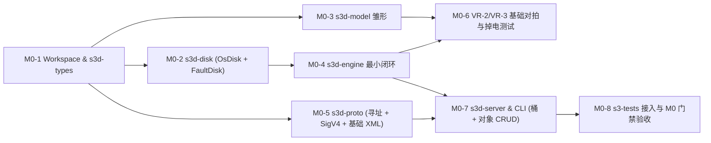

# 05 · 里程碑实施计划与待核实清单

本文档将《需求规格书》第 11～12 节的五个里程碑拆解为可逐步交付的任务包，明确模块开发先后依赖，并跟踪 `Q1`～`Q6` 及边界行为的实测核实闭环。严格执行串行门禁：前一里程碑退出门槛全部绿灯后才进入下一里程碑。

---

## 1. M0 骨架（最小端到端闭环）拆解

**M0 目标**：跑通生产链路与对拍/故障注入底座，通过 `boto3` 冒烟，且 `s3-tests` 中 `bucket`（22 个）+ `object_core`（33 个）共 55 个用例通过 **≥ 44 个**。

| 任务包 | 交付内容 | 完成判据 |
| --- | --- | --- |
| **M0-1** Workspace 与领域类型 | 初始化 Cargo workspace（Rust 1.97, edition 2024, `#![forbid(unsafe_code)]`）；落地 `s3d-types`（`ObjectStore` trait、`VerifiedBodyStream`、桶名/key 校验规则、错误码枚举） | `cargo check --workspace` 零警告；第 7 节桶名与限额单元测试通过 |
| **M0-2** `s3d-disk` 双实现 | 实现 `OsDisk`（`pread`/`pwrite`/`fdatasync`/`sync_dir`/`flock`/`statvfs`）与内存 `FaultDisk`（未刷盘丢弃、4 KiB 扇区撕裂、目录未刷盘丢弃、`EIO` 注入）；`OsDisk` 过 Miri | `OsDisk` 与 `FaultDisk` 共用同一套契约测试集全部通过 |
| **M0-3** `s3d-model` 雏形 | 用 `BTreeMap` 实现桶增删查（`ListBuckets`、`CreateBucket`、`HeadBucket`、`DeleteBucket`、`GetBucketLocation`）与对象基础读写删（`PutObject`、`GetObject`、`HeadObject`、`DeleteObject`、Range、基础元数据与 MD5/CRC64NVME） | 模型单测覆盖上述操作语义 |
| **M0-4** `s3d-engine` 最小闭环 | 落地 `FORMAT`、段文件追加写与 CRC32C 块校验、WAL 写入与 Group Commit、内存 `MemoryCatalog`、启动重放恢复（含 `synced_lsn` 撕裂截断）、`fsync EIO` 只读熔断 | 引擎通过与 `M0-3` 相同的契约测试集 |
| **M0-5** `s3d-proto` 核心 | Path-style 寻址、单次 URI 解码、SigV4 Header 验签（含派生密钥缓存与 `100-continue` 衔接）、`UNSIGNED-PAYLOAD` 与流式摘要、错误 XML 与桶基础 XML 编解码（关闭 DTD/实体） | 正反向 SigV4 单元测试与 XXE 拒绝测试通过 |
| **M0-6** 验证底座首跑 | 接通 `VR-2`（proptest 引擎 vs 模型对拍）与 `VR-3`（`FaultDisk` 随机掉电恢复判定器）在 M0 操作子集上运行 | 对拍 10,000 条 0 差异；掉电 1,000 次 0 违例 |
| **M0-7** `s3d-server` 与 CLI | 实现 `s3d serve`、`s3d.toml` 解析、`credentials.toml`（0600 权限校验 + 6 账号加载）、连接/头大小保护、独立管理端口 `/health` | `boto3` 冒烟脚本（建桶、PUT、GET、Range、HEAD、DELETE、删桶）全绿 |
| **M0-8** `s3-tests` 接入与验收 | 编写 `scripts/classify_s3tests.py`，用 `tox --collect-only` 复核 545 用例目标集；生成 `s3d.conf`；跑 `bucket` + `object_core` 55 个用例，登记首批 `docs/deviations.md` | **55 个用例通过 ≥ 44 个**，存档首份 JUnit XML |

---

## 2. M1～M4 任务包与退出门槛

### M1 · P0 全量功能与验证闭环
- **协议扩展（`s3d-proto`）**：
  - 预签名 URL（`PR-10`）、`Transfer-Encoding: chunked`（`PR-14`）、`aws-chunked` 流式验签与 `STREAMING-UNSIGNED-PAYLOAD-TRAILER`（`PR-12`, `PR-27`）。
  - 全部 P0 校验和（CRC32、CRC32C、CRC64NVME、SHA1、SHA256、`Content-MD5`）及 GF(2) CRC 全对象合并算法（`PR-20`～`PR-26`）。
  - `VR-8`：`botocore` 与 `aws-sigv4` 10,000 组差分及单点篡改测试全过。
- **引擎与模型同步扩展（`s3d-engine` + `s3d-model`）**：
  - `ListObjects`（V1）与 `ListObjectsV2`（含前缀二分跳过优化与 HMAC `continuation-token`，`FR-39`～`FR-45`）。
  - 完整分片上传生命周期（`Create` / `UploadPart` / `UploadPartCopy` / `Complete` 24h 幂等保留 / `Abort` / `ListParts` / `ListMultipartUploads`，`FR-24`～`FR-31`）。
  - `CopyObject`（`FR-18`～`FR-23`）、`DeleteObjects`（`FR-46`～`FR-47`）、`GetObjectAttributes`。
  - 全套条件读、条件写与条件删除（提交点求值，`FR-12`～`FR-17`）。
- **M1 退出门槛**：
  - [ ] P0 目标集通过 **≥ 237 / 249**，未通过项全部记入 `docs/deviations.md`；
  - [ ] `VR-2` 随机序列对拍 **100,000 条 0 差异**；
  - [ ] `VR-3` 随机掉电注入 **10,000 次 0 违例**；
  - [ ] `VR-6` `boto3` + `awscli v1` 真实客户端脚本（含 1 GiB 分片上传下载 SHA-256 比对）全部通过。

### M2 · P1 多租户授权、版本控制与高级协议
- **细化设计前置**：开工前在 `docs/03-protocol-and-api.md` 第 6 节补全 Bucket Policy 支持的条件运算符精确表、ACL XML/Header 映射表与 `PostObject` 表单校验细则。
- **核心交付**：
  - 版本控制状态机、`versionId` 编码、删除标记与 `ListObjectVersions`（`FR-32`～`FR-38`）。
  - 桶与对象标签（`?tagging`）及 `x-amz-tagging-directive`。
  - Object Ownership（`BucketOwnerEnforced` / `ObjectWriter` / `BucketOwnerPreferred`）、桶/对象 ACL（`?acl`）。
  - Bucket Policy 解析与求值、`?policyStatus`、`PublicAccessBlock`（`PR-30`～`PR-33`）。
  - CORS 配置与 `OPTIONS` 预检、浏览器表单 `PostObject`、`STREAMING-AWS4-HMAC-SHA256-PAYLOAD-TRAILER`、Virtual-Hosted 寻址（`PR-2`）。
  - 同步将上述全部语义补入 `s3d-model` 与 `VR-2` 生成器。
- **M2 退出门槛**：
  - [ ] P0 目标集提升至 **≥ 245 / 249**；
  - [ ] P1 目标集通过 **≥ 171 / 190**，更新 `docs/deviations.md` 与 JUnit 报告。

### M3 · 存储加固、可观测性与性能达标
- **核心交付**：
  - 定期与定量检查点（`ckpt-<lsn>`）生成、恢复加速与旧 WAL 裁剪（`ST-8`, `NFR-6`）。
  - 后台与手动段压缩 GC（`s3d compact`、`SegmentPin` 无锁引用保护、低磁盘空间 `503 SlowDown` 保护 `NFR-16`）。
  - 离线全量校验工具 `s3d fsck`（`NFR-13`）及损坏注入回归测试。
  - JSON 结构化访问日志（`NFR-10`）、Prometheus `/metrics` 全量指标（`NFR-11`）、SIGTERM 30s 优雅停机（`NFR-14`）。
  - 落地 `VR-4`（Loom + Shuttle + `s3d-check` WGL 线性一致性检查器）、`VR-7`（8 个 `cargo-fuzz` 目标）、`VR-9`（`s3d-bench` 与 `fio` 基线对标调优）。
- **M3 退出门槛**：
  - [ ] `NFR-1`～`NFR-6` 全部达标（按验收机 `fio` 基线锁定）；
  - [ ] `VR-3` 掉电注入（含并发 GC 与检查点）**100,000 次 0 违例**；
  - [ ] `VR-4` 单 key 线性一致性检查 **10,000 条历史 0 违例**；
  - [ ] `VR-7` 全部 8 个 fuzz 目标各跑 **≥ 1 小时 0 崩溃**；
  - [ ] `s3d fsck` 对验收数据集报告 `0` 错误。

### M4 · P2 企业级特性（选做）
- **核心交付**：对象锁（Governance / Compliance 保留期与 Legal Hold）、生命周期过期后台执行器（`?lifecycle`）、服务端加密（SSE-S3 与 SSE-C）、桶日志配置（`?logging`）及可选 TLS / 扩展哈希算法。
- **M4 退出门槛**：
  - [ ] P2 目标集通过 **≥ 85 / 106**（参数化用例全展开项通过计 1 函数），且 P0/P1/M3 各项指标无退化。

---

## 3. 未决问题与实测核实跟踪表（`Q1`～`Q6` 及边界项）

| 编号 | 待核实事项 | 当前设计取值 | 核实方式与计划节点 | 状态 |
| --- | --- | --- | --- | --- |
| `Audit-1` | 附录 B `tox` 过滤表达式实际收集出的测试函数数是否精确等于 545 | 静态归类为 545（P0=249, P1=190, P2=106） | **M0-8** 已执行 `pytest --collect-only` 复核：收集 563 个展开项，去重后精确等于 **545** 个测试函数 | **已核实闭环** |
| `Q1` | `CreateMultipartUpload` 省略 `x-amz-checksum-type` 时 CRC32 / CRC32C / SHA1 / SHA256 的默认类型 | `CRC64NVME` 取 `FULL_OBJECT`，其余取 `COMPOSITE`（`PR-26`） | **M1** 对照 `s3-tests` `checksum`/`multipart` 用例断言；有 AWS 环境时抓包核实 | 暂定已落设计 |
| `Q2` | 新桶默认 `ObjectOwnership` | 配置项 `default_object_ownership` 默认 `BucketOwnerEnforced`，`s3-tests` 配置设为 `ObjectWriter`（`FR-51`） | **M2** 跑 `acl` 与 `policy` 用例集验证 | 已锁定为配置项 |
| `Q3` / `FR-9` | `GetObject` 收到多区间 `Range`（如 `bytes=0-1,3-4`）的行为 | 忽略 `Range` 头，返回 `200 OK` 与完整对象 | **M0-8** 对照 `s3-tests` Range 用例全部通过 | **已核实闭环** |
| `Q4` | `versionId` 编码格式与长度 | 26 字符 URL 安全 Base32（编码 `seq: u64` + `rand: u64`，不透明、同 key 内可排序、≤ 64 字符） | **M2** 跑 `versioning` 31 个用例验证 | 暂定已落设计 |
| `Q5` | TLS 支持 | M0～M3 走明文 HTTP；TLS 放 P2 选做 | **M4** 视需求决定是否启用 `tokio-rustls` | 放入 P2 |
| `Q6` | MD5、XXHASH 系列、SHA512 校验和优先级 | 保持 P2（`PR-20`） | 持续观察 `boto3` 默认行为，v1 无需升至 P1 | 放入 P2 |
